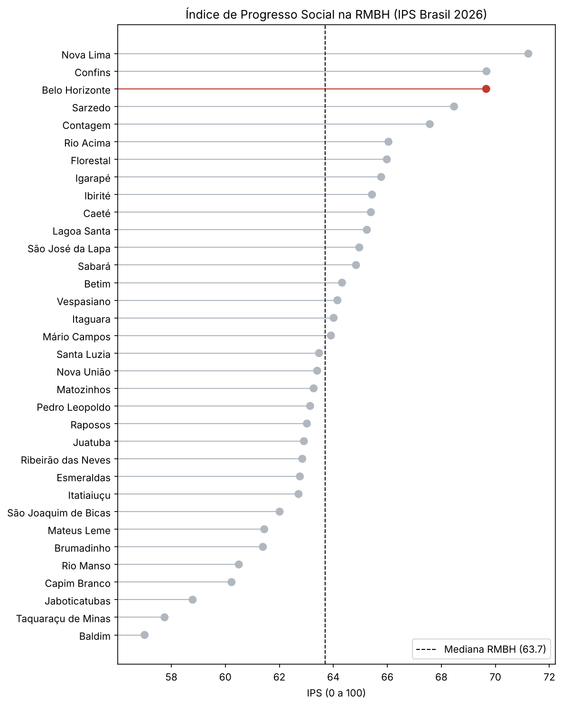
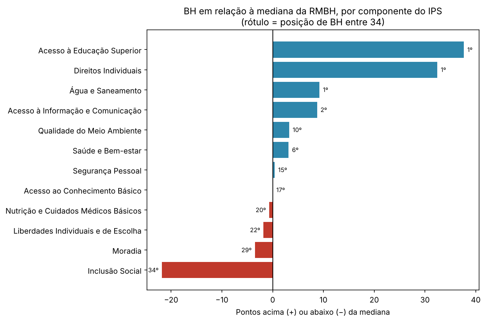
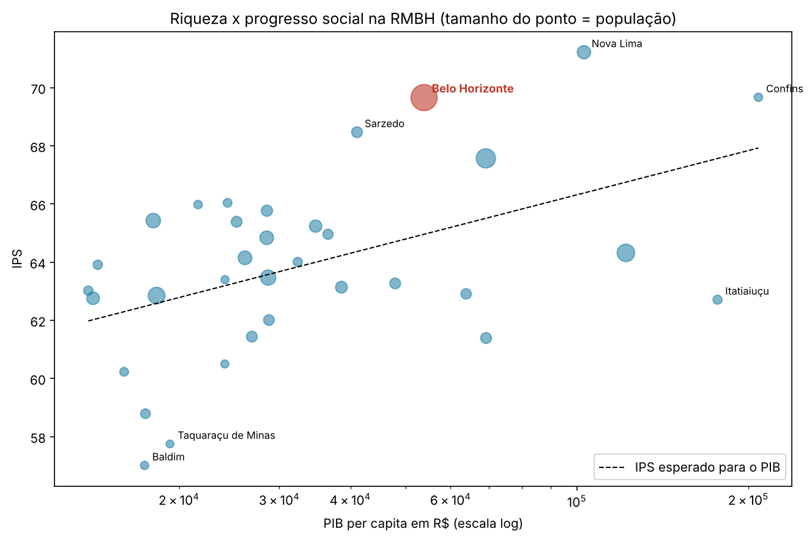
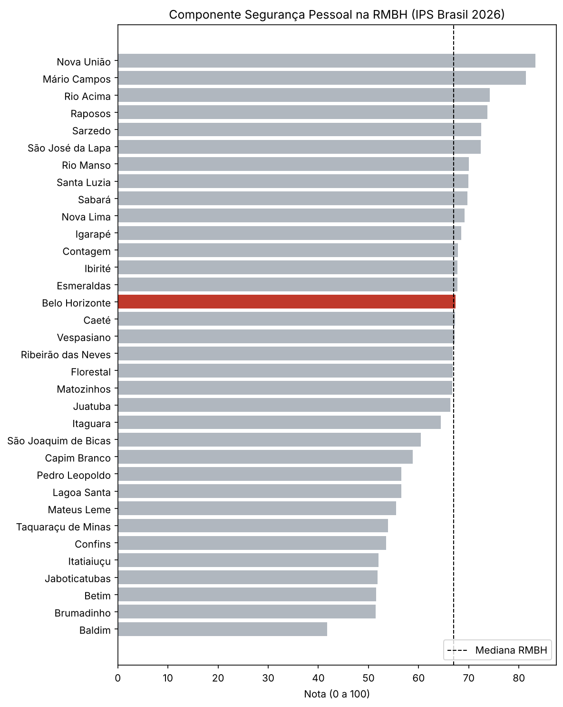
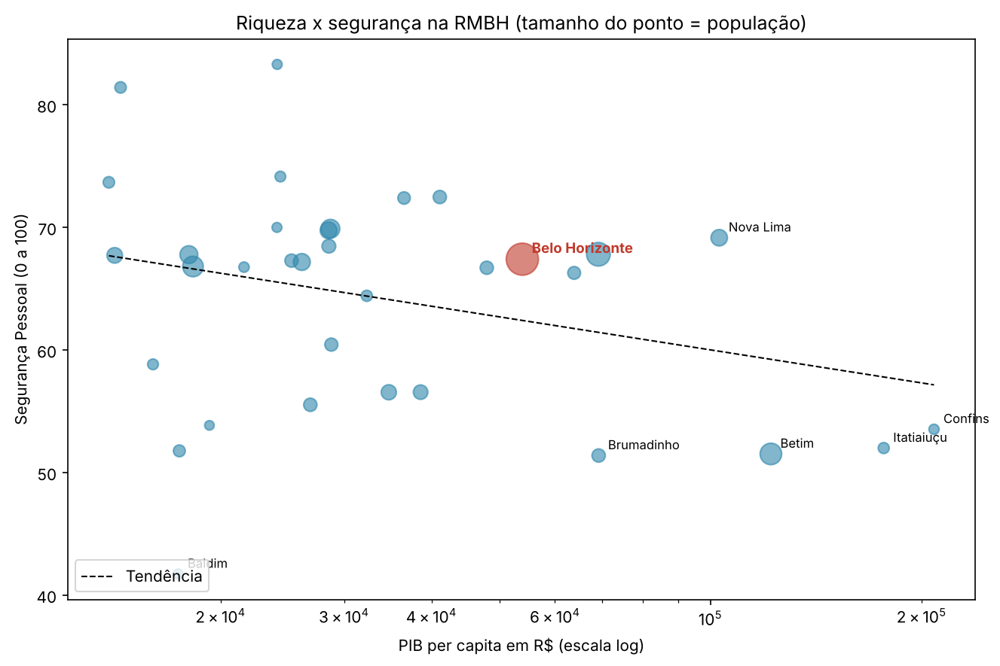

# BH e Região sob a perspectiva dos dados

Análise de como **Belo Horizonte** se posiciona em relação aos outros 33 municípios da **Região Metropolitana de Belo Horizonte (RMBH)** no **Índice de Progresso Social (IPS Brasil 2026)**: no índice geral, nas suas dimensões e componentes, em segurança e na relação com a riqueza econômica.

## Motivação

Faz pouco mais de um ano que moro em Belo Horizonte, e eu queria um projeto de análise de dados ligado ao meu dia a dia. Daí o tema: BH e região, vistas pelos dados.

A primeira ideia foi usar dados da Prefeitura de BH, mas a documentação mostrou que a base ia só até 2016. Por isso o projeto usa o [IPS Brasil](https://ipsbrasil.org.br), uma base atual que cobre todos os municípios do país, com indicadores de saúde, saneamento, educação, segurança, acesso à cultura e lazer, inclusão social e outros, além do PIB per capita.

## Perguntas

1. Onde BH está no ranking do IPS da RMBH?
2. O PIB per capita explica a qualidade de vida na região, ou a relação é mais fraca do que parece?
3. Renda mais alta significa mais segurança?
4. Quais dimensões do índice mais "puxam" BH para cima ou para baixo em comparação com os vizinhos?

## Principais resultados

**BH tem o 3º maior IPS da RMBH (69,66)**, atrás de Nova Lima (71,22) e praticamente empatada com Confins (69,67). A mediana da região é 63,69.



**O índice alto esconde um perfil desigual.** BH é a 1ª da região em Acesso à Educação Superior, Direitos Individuais e Água e Saneamento, mas é a **última (34ª) em Inclusão Social**, puxada principalmente pelo indicador Famílias em Situação de Rua. Também fica em 29º em Moradia.



**Riqueza e progresso social têm relação moderada** (correlação de 0,49 com o log do PIB per capita). BH tem progresso social acima do esperado para o seu PIB, assim como Nova Lima e Sarzedo. Já Itatiaiuçu tem um dos maiores PIB per capita da região e IPS abaixo da mediana.



**Em segurança, BH fica no meio da tabela** (15ª de 34). A taxa de homicídios é praticamente igual à mediana regional, e o pior indicador são as mortes por acidentes de transporte (26ª posição).



**Renda mais alta não significa mais segurança.** Na RMBH, a correlação entre o PIB per capita e a nota de Segurança Pessoal é fraca e **negativa** (−0,30): os municípios mais ricos tendem a ter segurança um pouco pior, e não melhor. Dos 5 municípios com maior PIB per capita, 4 estão entre os 6 piores em segurança. A exceção é Nova Lima.



## Uma decisão importante: só a edição 2026

O plano original era comparar a evolução de BH entre as edições 2024, 2025 e 2026. Mas o próprio IPS Brasil avisa que essas edições não são estritamente comparáveis, e os dados mostram por quê: o Enem passou de nota média para nota mediana, o indicador Trabalho Infantil saiu e entraram cinco novos, e a população de referência muda a cada edição.

Comparar as notas entre anos mostraria uma "evolução" que seria, em parte, só uma mudança de régua. Por isso as análises usam **somente a edição 2026**. Detalhes em [docs/comparabilidade_edicoes.md](docs/comparabilidade_edicoes.md).

## Estrutura do repositório

```
├── data/
│   ├── raw/                  # tabelas originais do IPS Brasil 2024, 2025 e 2026
│   └── processed/            # bases geradas pelo notebook 02 (MG e RMBH, edição 2026)
├── notebooks/
│   ├── 01_exploracao_edicoes.ipynb      # estrutura das 3 edições e por que não são comparáveis
│   ├── 02_limpeza_mg_rmbh.ipynb         # filtro de MG com DuckDB, checagens e base da RMBH
│   ├── 03_ranking_ips_rmbh.ipynb        # BH no ranking do IPS da RMBH
│   ├── 04_componentes_e_inclusao.ipynb  # dimensões, componentes e inclusão social
│   ├── 05_ips_x_pib.ipynb               # progresso social x PIB per capita
│   └── 06_seguranca.ipynb               # segurança, renda x segurança e conclusões
├── src/ips_rmbh/             # funções e configurações reutilizadas pelos notebooks
├── docs/                     # metodologia, dicionário de dados, comparabilidade e diário de bordo
├── reports/figures/          # gráficos gerados pelos notebooks
└── requirements.txt
```

## Documentação

- [Metodologia](docs/metodologia.md): fonte, recorte, checagens de qualidade e limitações.
- [Dicionário de dados](docs/dicionario_de_dados.md): as 78 colunas da base 2026, organizadas por dimensão e componente.
- [Comparabilidade das edições](docs/comparabilidade_edicoes.md): o que muda entre 2024, 2025 e 2026.
- [Diário de bordo](docs/diario_de_bordo.md): etapas do projeto e decisões de cada sprint.

## Como executar

**No Google Colab:** abra qualquer notebook pelo GitHub (Arquivo → Abrir notebook → GitHub). A primeira célula clona o repositório e ajusta as pastas sozinha.

**No computador:**

```bash
git clone https://github.com/millebns/ips-bh-rmbh.git
cd ips-bh-rmbh
pip install -r requirements.txt
jupyter notebook notebooks/
```

Rode os notebooks em ordem. O notebook 02 gera as bases de `data/processed/`, que os notebooks 03 a 06 usam.

## Ferramentas

Python, pandas, NumPy, DuckDB (SQL), Matplotlib e Jupyter/Google Colab.

## Uso de IA

Usei o Claude (Anthropic) para revisar o notebook e sugerir checagens. As decisões de análise, inclusive a de abrir mão da comparação entre edições, foram minhas.

## Autoria

**Camille Braga**: licenciada em Matemática e mestre em Modelagem Matemática e Ciências Computacionais.

## Fonte dos dados

Índice de Progresso Social Brasil, edições 2024, 2025 e 2026: [ipsbrasil.org.br](https://ipsbrasil.org.br).
